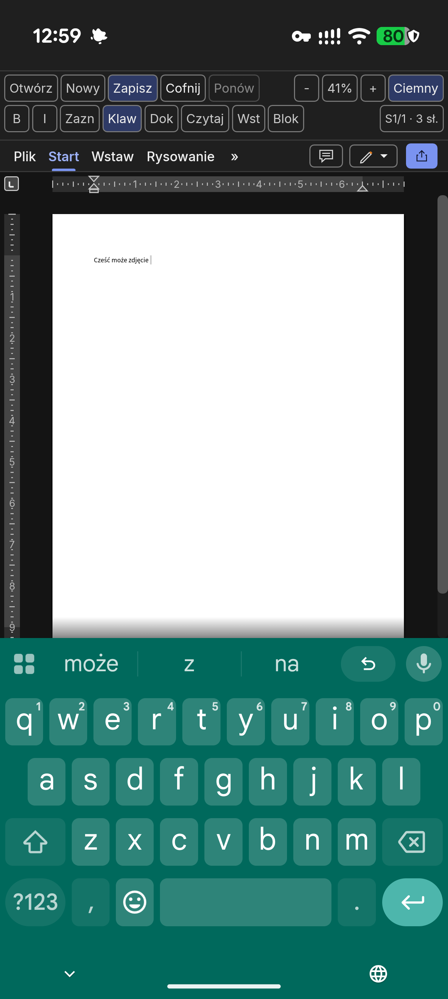
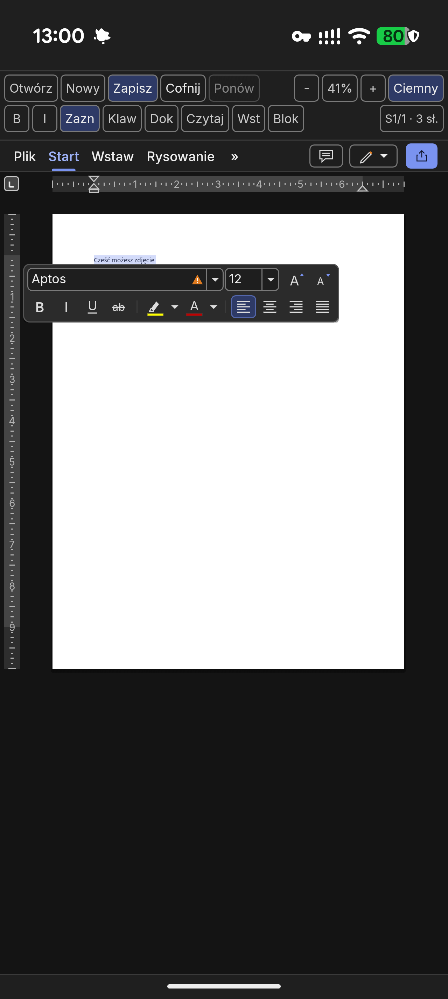

<p align="center">
  
</p>

<h1 align="center">WordCraft (APK)</h1>

<p align="center">
  <b>Nieoficjalny, w 100% offline edytor dokumentów dla Androida oparty na <a href="https://github.com/storytold/wordcraft">WordCraft</a></b><br>
  <sub>Unofficial 100% offline Android fork based on WordCraft (written in Rust &amp; Kotlin) · pod ikoną w systemie: <b>Word</b></sub>
</p>

<p align="center">
  
  
  
  
</p>

<p align="center">
  <a href="#funkcje">Funkcje</a> ·
  <a href="#zrzuty-ekranu">Zrzuty ekranu</a> ·
  <a href="#pobieranie-i-f-droid">Pobieranie i F-Droid</a> ·
  <a href="#budowanie-apk">Budowanie APK</a> ·
  <a href="LICENSE-MIT">MIT</a> ·
  <a href="LICENSE-APACHE">Apache-2.0</a> ·
  <a href="NOTICE">NOTICE</a> ·
  <a href="ATTRIBUTION.md">Attribution</a> ·
  <a href="SECURITY.md">Security</a>
</p>

> [!NOTE]
> To repozytorium (`lukasz-sklad/word-apk`) jest **nieoficjalnym, społecznościowym forkiem Androidowym** projektu [storytold/wordcraft](https://github.com/storytold/wordcraft).
> Działa w **100% offline** — w [`AndroidManifest.xml`](android/app/src/main/AndroidManifest.xml) brak uprawnienia `INTERNET`, nie ma tu Google Play Services, telemetrii, reklam ani wbudowanego mechanizmu aktualizacji sieciowych (`craft-update` wyłączony). Niewolne znaki towarowe (`docs/brand/`) zostały usunięte.
> **Błędy aplikacji mobilnej zgłaszaj w tym repozytorium ([Issues](https://github.com/lukasz-sklad/word-apk/issues)), nie u autorów wersji desktopowej.**

## Funkcje

* **Formaty plików:** otwiera i zapisuje `.docx` (OOXML), `.odt`, `.rtf`, `.html`, `.md`, `.txt`; otwiera starsze pliki `.doc` (97–2003); eksportuje PDF z zaznaczalnym tekstem.
* **Języki i pisownia offline:** spójna górna belka dotykowa **PL / EN**, wbudowany polski słownik Hunspell (`pl_PL`, SJP.PL) i reguły dzielenia wyrazów TeX oraz słownik angielski.
* **Klawiatura i dotyk:** poprawiona obsługa klawiatury Gboard / IME (podpowiedzi, autokorekta, dyktowanie głosowe, poprawki w środku zdania), tryb zaznaczania jednym palcem (`Zazn` / `Sel`) i powiększanie dwoma palcami.
* **Ekran i tryb okienkowy:** wykrywanie wycięcia aparatu (cutout), pasków systemowych i okien trybu komputerowego (Android desktop / freeform), motywy `System` / `Light` / `Sepia` / `Dark`.
* **Bezpieczeństwo danych:** kod bez `unsafe` i paników w silniku dokumentów, brak `wordcraft-mcp` i kanałów sieciowych w binarce Androida.

## Zrzuty ekranu

<table>
  <tr>
    <td align="center" width="50%">
      
      <br><sub>Pisanie po polsku z obsługą podpowiedzi Gboard</sub>
    </td>
    <td align="center" width="50%">
      
      <br><sub>Zaznaczanie jednym palcem (<code>Zazn</code>) i pasek narzędzi</sub>
    </td>
  </tr>
</table>

## Pobieranie i F-Droid

* **Wydania APK:** zakładka [Releases](https://github.com/lukasz-sklad/word-apk/releases) (w tym weryfikacja sum `SHA256SUMS.txt` dla wydań z tagów `v*`).
* **F-Droid (własne repozytorium GitHub Pages i przepis `fdroiddata`):**
  * Schemat numeracji **`<upstream>.<apk>`** — np. **`0.18.1.1`** (rdzeń WordCraft `0.18.1` + nasze wydanie `.1`), kolejna poprawka Androida to `0.18.1.2`, a po aktualizacji bazy do `0.19.0` → `0.19.0.1` przy stale rosnącym `versionCode`.
  * Konfiguracja repozytorium, sekretów podpisu i opis zgłoszenia do `fdroid/fdroiddata`: [`packaging/fdroid/README.md`](packaging/fdroid/README.md) · [`one.lmk.wordcraft.yml`](packaging/fdroid/one.lmk.wordcraft.yml).

## Budowanie APK

<details>
<summary>Pokaż instrukcję kompilacji lokalnej ze źródeł (Rust &gt;= 1.95, Android NDK r27c, JDK 17)</summary>

Wymagane: toolchain Rust z celami `aarch64-linux-android` i `x86_64-linux-android`, `cargo-ndk`, Android NDK `r27c` oraz JDK 17. Opcjonalnie katalog [`storytold/craft-i18n`](https://github.com/storytold/craft-i18n) na rewizji z [`craft-i18n.rev`](craft-i18n.rev) wskazany zmienną `CRAFT_I18N_DIR`.

```sh
# 1. Testy Rusta
cargo test -p wordcraft-android

# 2. Kompilacja bibliotek natywnych (.so) z wyrównaniem stron 16 KB
RUSTFLAGS="-C link-arg=-Wl,-z,max-page-size=16384" \
  cargo ndk -t arm64-v8a -t x86_64 -o android/app/src/main/jniLibs build --release -p wordcraft-android

# 3. Testy jednostkowe Kotlina, Lint i budowa APK
cd android
./gradlew testDebugUnitTest lintDebug assembleDebug assembleRelease --no-daemon
```

Wyniki trafiają do `android/app/build/outputs/apk/{debug,release}/`.

</details>

## Licencje i pochodzenie

<details>
<summary>Zestawienie licencji: kod MIT OR Apache-2.0, czcionki OFL-1.1, słownik polski SJP.PL (Apache-2.0 / MIT)</summary>

| Składnik | Licencja | Plik / źródło |
|---|---|---|
| Kod WordCraft oraz forka Androida (`lukasz-sklad/word-apk`) | **`MIT` OR `Apache-2.0`** | [`LICENSE-MIT`](LICENSE-MIT) · [`LICENSE-APACHE`](LICENSE-APACHE) · [`NOTICE`](NOTICE) |
| Ikony, zrzuty ekranu i aktywa | Otwarte / własne | [`ATTRIBUTION.md`](ATTRIBUTION.md) |
| Wbudowane czcionki (`Inter`, `JetBrains Mono`, `Source Sans 3`, `Source Serif 4`) | **`OFL-1.1`** | `assets/fonts/OFL-*.txt` |
| Polski słownik Hunspell (`pl_PL`, SJP.PL) | **`Apache-2.0`** | `android/app/src/main/assets/language-packs/pl/LICENCES/` |
| Polskie reguły dzielenia wyrazów TeX | **`MIT`** | `android/app/src/main/assets/language-packs/pl/LICENCES/MIT.txt` |
| Korekta angielska (Moby Hyphenator II / SCOWL) | Public Domain / MIT-like | [`NOTICE`](NOTICE) |

</details>

---

<p align="center">
  <sub>Unofficial Android fork based on <a href="https://github.com/storytold/wordcraft">WordCraft</a> — 100% FLOSS &amp; offline.</sub>
</p>
