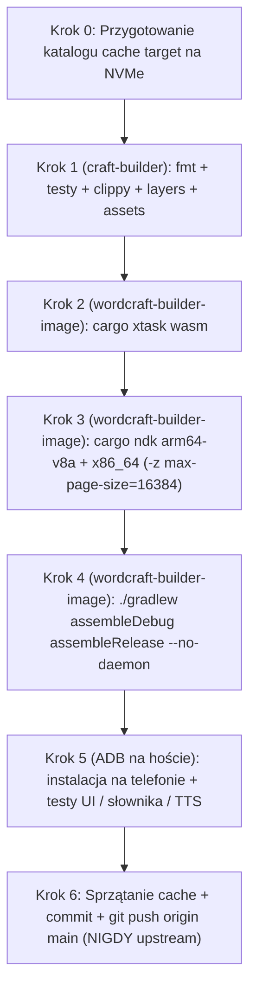

# Wytyczne budowania i publikacji WordCraft Android (`word-apk`)

Kompletny przewodnik techniczny (oraz zestaw instrukcji startowych dla agenta/dewelopera) do budowania, testowania i wydawania aplikacji **WordCraft Android** (`one.lmk.wordcraft`) na systemie **SteamOS** z użyciem kontenerów **Podman**, **cargo-ndk**, **Gradle** oraz telefonu testowego przez **ADB**.

---

## 1. Cel, repozytorium i reguły Git (`origin` vs `upstream`)

* **Lokalne repozytorium:** `/home/deck/GIT/android/craft/word-apk`
* **Zdalne repozytoria (`git remote`):**
  * **`origin`**: `git@github.com:lukasz-sklad/word-apk.git` — docelowe repozytorium wersji Androidowej (**tutaj** wypychamy commity przez `git push origin main`).
  * **`upstream`**: `https://github.com/storytold/wordcraft.git` — oficjalne repozytorium nadrzędne Storytold. **Nigdy nie wykonuj bezpośredniego `git push` do `upstream`.**
* **Synchronizacja z `upstream` (opcjonalnie przed większym wydaniem):**
  Pobieraj zmiany przez `git fetch upstream` i łącz je lokalnie (`merge`/`rebase`) z zachowaniem naszych modyfikacji specyficznych dla Androida (`apps/wordcraft-android/`, `android/`, integracje lokalizacji i TTS).

---

## 2. Architektura aplikacji Android (`wordcraft-android`)

| Warstwa | Lokalizacja w repozytorium | Rola i kluczowe parametry |
|---|---|---|
| **Natywny rdzeń Rust** | `apps/wordcraft-android/` | Biblioteka `cdylib` (`libwordcraft_android.so`), oparta o `eframe` `0.37` + `egui` `0.37` + `wgpu` + `android-activity` (`GameActivity`) |
| **Mostek Android / IME / TTS** | `apps/wordcraft-android/src/{android.rs, mobile.rs, ime.rs}` | Pętla `android_main`, układ mobilny (`ViewMode::Print`, `NARROW_VIEWPORT_DP = 760.0`), przycisk `Czytaj` (`CzytajController`), obsługa `Kla` i JNI Google `TextToSpeech` |
| **Silnik i lokalizacja Rust** | `crates/ui-egui/src/i18n.rs`, `crates/engine/src/speech.rs` | `lang_from_override` dla listy z `WORDCRAFT_LANGUAGE`, `PlatformSpeaker` / `set_platform_speaker` podpięte w `speak()` |
| **Powłoka Kotlin / Android** | `android/app/src/main/java/one/lmk/wordcraft/{WordCraftApp.kt, WordCraftActivity.kt}` | Eksport `WORDCRAFT_LANGUAGE` / `WORDCRAFT_REGION` przez `Os.setenv`, rozpakowanie `language-packs/pl`, `GameActivity`, `TextToSpeech` + `UtteranceProgressListener` |
| **Manifest i zasoby APK** | `android/app/src/main/AndroidManifest.xml`, `android/app/src/main/assets/language-packs/pl/` | `INTERNET`, `<queries>` (`TTS_SERVICE`), zaszyty słownik `sjp.pl` (`pack.toml`, `spelling.dic`, `spelling.aff`, `hyphenation.pat`, `LICENCES/*`) |
| **Konfiguracja Gradle** | `android/app/build.gradle.kts`, `android/gradle/libs.versions.toml` | `applicationId = "one.lmk.wordcraft"`, `versionName = "0.18.1"`, AGP `9.5.1`, Gradle `9.8.2`, `compileSdk = 37`, `minSdk = 26`, `targetSdk = 36`, ABI `arm64-v8a` + `x86_64`, `JavaVersion.VERSION_17`, `isMinifyEnabled = true`, `isShrinkResources = true` |

---

## 3. Obowiązkowe wytyczne jakości i ograniczenia środowiska

1. **System bazowy SteamOS jest tylko do odczytu (`read-only` rootFS):**
   * Nie instaluj narzędzi kompilacyjnych ani bibliotek w systemie hosta.
   * Wszelkie kompilacje, testy Rust, `cargo ndk` i `./gradlew` uruchamiaj **wyłącznie w kontenerach Podman**, a pamięć podręczną i katalogi `target` trzymaj na szybkim dysku **NVMe** (`/home/deck/.cache/...`), **nigdy** w RAM-owym `/tmp`.
2. **Bezpieczeństwo kodu Rust (`AGENTS.md` — Never Crash):**
   * W kodzie produkcyjnym obowiązuje zakaz `unwrap()`, `expect()`, `panic!`, `unreachable!`, `todo!`, `unimplemented!` oraz `unsafe` (`Session::run` to jedynie ostatnia linia obrony). Błędy zwracaj przez `Result`.
   * Dane wejściowe z plików, JNI i parametrów poleceń traktuj jako niezaufane (bezpieczne indeksowanie `.get()`, sprawdzanie granic znaków UTF-8, arytmetyka nasycona/kontrolowana).
3. **Polityka zasobów (`ATTRIBUTION.md` + `cargo xtask assets`):**
   * Bezwzględny zakaz kopiowania ikon, obrazów czy czcionek z produktów Microsoft/Adobe/Avid/Autodesk.
   * Każdy nowy plik assetu (w tym paczki językowe w `android/app/src/main/assets/`) musi mieć wpis w `ATTRIBUTION.md` w tym samym commicie — inaczej `cargo xtask assets` zakończy się błędem.
4. **Zależność `craft-i18n` (`CRAFT_I18N_DIR`):**
   * Wersję słowników i wzorców podziału wyrazów przypina plik `craft-i18n.rev` (`1e515422afdda2f317af430c1f9d68a5f83935b4`).
   * Podczas kompilacji Rusta i testów przekazuj `-e CRAFT_I18N_DIR=/craft-i18n` (zamontowane z `/home/deck/.cache/craft-i18n:ro`). W CI odpowiada za to `storytold/craft-common-actions/actions/checkout-craft-i18n@main` w `.github/workflows/android.yml`.
5. **Nie łam budowy WASM i warstw:**
   * Każda zmiana w współdzielonych crate'ach musi przejść `cargo xtask layers` i `cargo xtask wasm`.
   * Wspólnych plików `.github/workflows/*.yml` nie zmieniamy bez wyraźnej potrzeby CI.

---

## 4. Kontenery Podman i mapa katalogów na SteamOS

W procesie budowania współpracują dwa wyspecjalizowane obrazy kontenerowe:

| Obraz Podman | Zainstalowane narzędzia | Rola w potoku | Domyślne zmienne / pułapki |
|---|---|---|---|
| `localhost/craft-builder:latest` | `rustc 1.99.0`, `rustfmt 1.10.0-stable`, `clippy 0.1.99`, biblioteki systemowe Linux | `cargo fmt`, `cargo test`, `cargo clippy`, `cargo xtask layers`, `cargo xtask assets` | Brak `CARGO_HOME` w env (używa `/root/.cargo`) |
| `localhost/wordcraft-builder-image:latest` | `rustc 1.99.0`, target `wasm32-unknown-unknown`, `CARGO_HOME=/usr/local/cargo` | `cargo xtask wasm`, `cargo ndk` (arm64 + x86_64), `./gradlew` (Android APK/AAB) | Domyślnie `CARGO_TARGET_DIR=/tmp/target` — **zawsze** nadpisuj przez `-e CARGO_TARGET_DIR=/target`; wywołuj przez **`bash -c` (nigdy `bash -lc`)**; brak `rustfmt`/`clippy` |

### Kluczowe mapowania wolumenów i środowiska (NVMe + SDK + JBR)

* Repo projektu: `/home/deck/GIT/android/craft/word-apk:/work` (`-w /work`)
* Cache kompilacji Rust: `/home/deck/.cache/wordcraft-android-target:/target` (`-e CARGO_TARGET_DIR=/target`)
* Cache rejestrów Cargo: `/home/deck/.cache/cargo/registry` i `/home/deck/.cache/cargo/git`
  * w `craft-builder`: montowane pod `/root/.cargo/registry` i `/root/.cargo/git`
  * w `wordcraft-builder-image`: montowane pod `/usr/local/cargo/registry` i `/usr/local/cargo/git`
* Słowniki `craft-i18n`: `/home/deck/.cache/craft-i18n:/craft-i18n:ro` (`-e CRAFT_I18N_DIR=/craft-i18n`)
* Toolchain Android Rust (`aarch64-linux-android`, `x86_64-linux-android`): `/home/deck/.cache/wordcraft-rustup:/rustup:ro` (`RUSTUP_HOME=/rustup` **tylko** dla `cargo ndk`)
* Binaria Cargo (`cargo-ndk 4.1.2`): `/home/deck/.cache/wordcraft-cargo-bin:/cargo-bin:ro` (`PATH=/cargo-bin/bin:$PATH` **tylko** dla `cargo ndk`)
* Android SDK i NDK `27.2.12479018`:
  * `/home/deck/Android/Sdk:/android-sdk` (`ANDROID_HOME=/android-sdk`, `ANDROID_SDK_ROOT=/android-sdk`)
  * `/home/deck/Android/Sdk/ndk/27.2.12479018:/ndk` (`ANDROID_NDK_HOME=/ndk`)
* Java SDK dla Gradle (JBR `25.0.4` z Flatpaka Android Studio): `/var/lib/flatpak/app/com.google.AndroidStudio/current/active/files/extra/jbr:/jbr:ro` (`JAVA_HOME=/jbr`)
* Cache Gradle i klucz debugowy Androida: `/home/deck/.gradle:/root/.gradle` oraz `/home/deck/.android:/root/.android` (dzięki stałemu `debug.keystore` aktualizacja przez `adb -d install -r` nie zmienia podpisu)

> [!IMPORTANT]
> **Krytyczne pułapki w Podmanie na SteamOS:**
> 1. **Używaj `bash -c`, nie `bash -lc`:** powłoka logowania `-lc` w `wordcraft-builder-image` nadpisuje `PATH` i ucina `/usr/local/cargo/bin`.
> 2. **Nie przekazuj `--userns=keep-id` bez jawnego `HOME`:** z tą flagą `HOME` spada na `/`, co powoduje błąd `Permission denied` przy `/.rustup`. W rootless Podman bez `--userns=keep-id` UID 0 w kontenerze mapuje się bezpośrednio na użytkownika `deck`.
> 3. **Flagi wyrównania 16 KB dla Androida 15+:** przy wywołaniu `cargo ndk` zawsze ustaw `RUSTFLAGS="-C link-arg=-Wl,-z,max-page-size=16384"`.

---

## 5. Schemat procesu budowania i weryfikacji



---

## 6. Polecenia krok po kroku (gotowe do wykonania)

### Krok 0 — Przygotowanie katalogu `target` na NVMe

```bash
mkdir -p /home/deck/.cache/wordcraft-android-target
```

### Krok 1 — Testy Rust, Clippy, formatowanie i bramki `xtask` (`craft-builder`)

```bash
podman run --rm \
  -v /home/deck/GIT/android/craft/word-apk:/work \
  -v /home/deck/.cache/wordcraft-android-target:/target \
  -v /home/deck/.cache/cargo/registry:/root/.cargo/registry \
  -v /home/deck/.cache/cargo/git:/root/.cargo/git \
  -v /home/deck/.cache/craft-i18n:/craft-i18n:ro \
  -w /work \
  -e CARGO_TARGET_DIR=/target \
  -e CRAFT_I18N_DIR=/craft-i18n \
  localhost/craft-builder:latest \
  bash -c '
    set -euo pipefail
    cargo fmt --all -- --check
    cargo test -p wordcraft-android
    cargo test -p wordcraft-engine speech::
    cargo test -p wordcraft-ui-egui i18n::
    cargo clippy --workspace --all-targets -- -D warnings
    cargo xtask layers
    cargo xtask assets
  '
```

### Krok 2 — Weryfikacja zgodności WebAssembly (`wordcraft-builder-image`)

```bash
podman run --rm \
  -v /home/deck/GIT/android/craft/word-apk:/work \
  -v /home/deck/.cache/wordcraft-android-target:/target \
  -v /home/deck/.cache/cargo/registry:/usr/local/cargo/registry \
  -v /home/deck/.cache/cargo/git:/usr/local/cargo/git \
  -v /home/deck/.cache/craft-i18n:/craft-i18n:ro \
  -w /work \
  -e CARGO_TARGET_DIR=/target \
  -e CRAFT_I18N_DIR=/craft-i18n \
  localhost/wordcraft-builder-image:latest \
  bash -c 'set -euo pipefail && cargo xtask wasm'
```

### Krok 3 — Kompilacja natywnych bibliotek `.so` przez `cargo ndk`

Generuje `android/app/src/main/jniLibs/arm64-v8a/libwordcraft_android.so` oraz `android/app/src/main/jniLibs/x86_64/libwordcraft_android.so` (katalog `jniLibs/` jest ignorowany w `.gitignore`):

```bash
podman run --rm \
  -v /home/deck/GIT/android/craft/word-apk:/work \
  -v /home/deck/.cache/wordcraft-android-target:/target \
  -v /home/deck/.cache/cargo/registry:/usr/local/cargo/registry \
  -v /home/deck/.cache/cargo/git:/usr/local/cargo/git \
  -v /home/deck/.cache/craft-i18n:/craft-i18n:ro \
  -v /home/deck/.cache/wordcraft-rustup:/rustup:ro \
  -v /home/deck/.cache/wordcraft-cargo-bin:/cargo-bin:ro \
  -v /home/deck/Android/Sdk/ndk/27.2.12479018:/ndk:ro \
  -w /work \
  -e CARGO_TARGET_DIR=/target \
  -e CRAFT_I18N_DIR=/craft-i18n \
  -e RUSTUP_HOME=/rustup \
  -e ANDROID_NDK_HOME=/ndk \
  -e RUSTFLAGS='-C link-arg=-Wl,-z,max-page-size=16384' \
  localhost/wordcraft-builder-image:latest \
  bash -c '
    set -euo pipefail
    export PATH="/cargo-bin/bin:$PATH"
    cargo ndk -t arm64-v8a -t x86_64 -o android/app/src/main/jniLibs build --release -p wordcraft-android
  '
```

### Krok 4 — Budowa paczek Android APK przez Gradle (`./gradlew`)

```bash
podman run --rm \
  -v /home/deck/GIT/android/craft/word-apk:/work \
  -v /home/deck/Android/Sdk:/android-sdk \
  -v /home/deck/.gradle:/root/.gradle \
  -v /home/deck/.android:/root/.android \
  -v /var/lib/flatpak/app/com.google.AndroidStudio/current/active/files/extra/jbr:/jbr:ro \
  -w /work/android \
  -e JAVA_HOME=/jbr \
  -e ANDROID_HOME=/android-sdk \
  -e ANDROID_SDK_ROOT=/android-sdk \
  localhost/wordcraft-builder-image:latest \
  bash -c 'set -euo pipefail && ./gradlew assembleDebug assembleRelease --no-daemon'
```

Wyjściowe artefakty:
* Debug APK (podpisany kluczem debugowym, gotowy do `adb install`): `android/app/build/outputs/apk/debug/app-debug.apk`
* Release APK (niepodpisany lokalnie bez klucza produkcyjnego): `android/app/build/outputs/apk/release/app-release-unsigned.apk`

> Uwaga: na GitHub Actions (`.github/workflows/android.yml`) budowany jest również podpisany pakiet AAB oraz Release APK (`./gradlew bundleRelease assembleRelease`) z wykorzystaniem sekretów `ANDROID_KEYSTORE_BASE64`, `ANDROID_KEYSTORE_PASSWORD`, `ANDROID_KEY_ALIAS`, `ANDROID_KEY_PASSWORD`. **Nigdy nie przechowuj sekretów ani plików `.keystore` w repozytorium.**

### Krok 5 — Instalacja i weryfikacja na telefonie przez ADB

Na hoście SteamOS używamy `/home/deck/Android/Sdk/platform-tools/adb`:

```bash
adb devices
adb -d install -r /home/deck/GIT/android/craft/word-apk/android/app/build/outputs/apk/debug/app-debug.apk
adb -d shell am start -n one.lmk.wordcraft/.WordCraftActivity
```

Checklist weryfikacji na urządzeniu (np. Pixel 9 Pro po USB `-d`):
1. **Język i układ startowy:** interfejs startuje w języku systemu (PL: `Plik | Start | Wstaw | Rysowanie`) w trybie strony (`Print` / przycisk `Dok`), dopasowany do szerokości ekranu (`PageWidth`).
2. **Słownik offline (`pl_PL`):** sprawdź istnienie plików w katalogu danych aplikacji `files/font-store/language-packs/pl/`, działanie podkreśleń błędów pisowni offline oraz ekran *Opcje ▸ Język*.
3. **Trwałość wyboru języka:** zmień język w UI, sprawdź zapis `"language"` w `files/ui.json`, wykonaj `adb -d shell am force-stop one.lmk.wordcraft` i uruchom ponownie.
4. **Lektor `Czytaj` / Google TTS:** wciśnij `Czytaj`, sprawdź w `adb -d logcat` wywołania `TextToSpeech` (`com.google.android.tts`), zatrzymanie i wznowienie od zapamiętanej pozycji oraz czytanie zaznaczenia.

### Krok 6 — Sprzątanie i wypchnięcie zmian wyłącznie na `origin/main`

```bash
cd /home/deck/GIT/android/craft/word-apk
git status
# Opcjonalnie po zakończeniu iteracji usuń duży katalog target z cache NVMe:
# rm -rf /home/deck/.cache/wordcraft-android-target
```

Publikacja zmian na GitHub:
1. Przejrzyj dokładnie `git status` i `git diff`, upewniając się, że nie dodajesz artefaktów budowania ani poufnych danych.
2. Zatwierdź zmiany czytelnym commitem (`git add ... && git commit -m "..."`).
3. Wypchnij **wyłącznie na `origin`**, nigdy na `upstream`:

```bash
git push origin main
```

4. Sprawdź wynik wszystkich 5 workflowów w GitHub Actions (`CI`, `Packaging lint`, `SonarCloud`, `Android CI / CD & CVE Security Audit`, `Printing`), w tym skan CodeQL `java-kotlin`.

---

## 7. Tryb lekki — budowa i testy na GitHub Actions (bez lokalnego APK)

Nie za każdym razem trzeba kompilować cały projekt NDK i Gradle lokalnie na Steam Decku. Masz skonfigurowaną pełną automatyzację CI/CD w repozytorium `lukasz-sklad/word-apk`:

* **Kiedy wybierać tryb lekki (GitHub Actions):**
  * przy pobieraniu i scalaniu aktualizacji z `upstream/main` bez dużych zmian własnego UI Androida,
  * przy drobnych poprawkach kodu/dokumentacji lub gdy chcesz dostać gotową paczkę **Release APK / AAB podpisaną stałym kluczem produkcyjnym** z sekretów GitHuba (bez rozjazdu podpisów debugowych).
* **Minimalna kontrola lokalna przed `git push origin main` (`localhost/craft-builder:latest`):**
  ```bash
  podman run --rm \
    -v /home/deck/GIT/android/craft/word-apk:/work \
    -v /home/deck/.cache/wordcraft-android-target:/target \
    -v /home/deck/.cache/cargo/registry:/root/.cargo/registry \
    -v /home/deck/.cache/cargo/git:/root/.cargo/git \
    -w /work \
    -e CARGO_TARGET_DIR=/target \
    localhost/craft-builder:latest \
    bash -c 'set -euo pipefail && cargo fmt --all -- --check && cargo xtask layers && cargo xtask assets'
  ```
  *(Przy większym scaleniu lub zmianach w Rust warto dodatkowo uruchomić `cargo clippy --workspace --all-targets -- -D warnings` przed wypchnięciem, żeby nie czekać kilkanaście minut na błąd składni w Actions.)*
* **Co automatycznie wykona GitHub Actions po `git push origin main`:**
  * `ci.yml` — uruchomi pełne `cargo xtask ci` (wszystkie testy jednostkowe/integracyjne, `clippy`, `fmt`, `layers`, `assets`, `wasm`),
  * `android.yml` — zbuduje natywne biblioteki `.so` (`arm64-v8a` i `x86_64`), spakuje i podpisze Release **APK oraz AAB** oraz przeprowadzi audyt bezpieczeństwa **CodeQL (`java-kotlin`)**,
  * `printing.yml`, `packaging-lint.yml`, `sonarcloud.yml` — zweryfikują drukowanie, paczkowanie i analizę statyczną.

---

## 8. Szybka checklista gotowości (Definition of Done)

* [ ] Brak `unwrap()` / `expect()` / `panic!` / `unsafe` w kodzie produkcyjnym Rust.
* [ ] Każdy nowy asset wpisany w `ATTRIBUTION.md` (`cargo xtask assets` przechodzi).
* [ ] W trybie pełnym: `cargo fmt --all -- --check`, `cargo clippy --workspace --all-targets -- -D warnings`, `cargo xtask layers`, `cargo xtask wasm` i testy (`wordcraft-android`, `speech::`, `i18n::`) przechodzą z `CRAFT_I18N_DIR=/craft-i18n` (w trybie lekkim minimalnie `fmt` + `layers` + `assets`, a pełne testy i APK wykonuje GitHub Actions).
* [ ] Przy lokalnej budowie APK: biblioteki `.so` (`arm64-v8a` i `x86_64`) zbudowane z `-z max-page-size=16384`, `./gradlew assembleDebug assembleRelease --no-daemon` przechodzi z zamontowanym `/home/deck/.android:/root/.android` i zweryfikowane przez `adb`.
* [ ] Zmiany wypchnięte do `origin/main` (`lukasz-sklad/word-apk`), **bez** wypychania do `upstream` (`storytold/wordcraft`).
